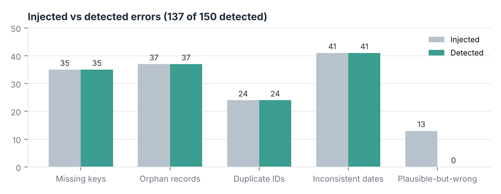
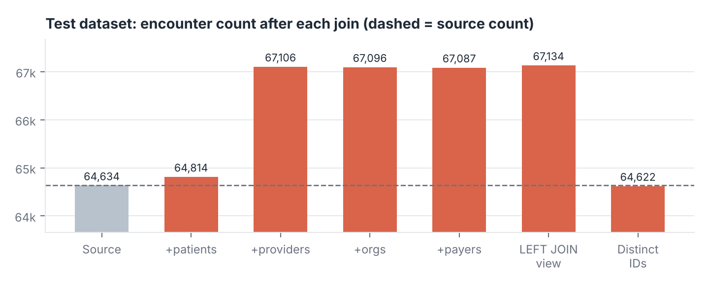

# Healthcare Encounter Reporting & Data Quality

**SQL (PostgreSQL) · Python · Synthea synthetic data**

A PostgreSQL reporting layer and data-quality layer built on synthetic health records from [Synthea](https://github.com/synthetichealth/synthea). The project answers two questions: what does encounter volume look like by class and visit type, and can the validation checks be trusted to catch the errors that break reporting?

> All data is synthetic, generated by Synthea (MITRE). No real patient data is used.

## Results at a glance

| | |
|---|---|
| Related tables | 9 (patients, encounters, providers, organizations, payers, conditions, procedures, medications, immunizations) |
| Synthetic patients / encounters | 1,141 / 64,622 |
| SQL reporting views | 8 |
| Validation checks | 40 (11 missing keys, 10 orphan records, 8 duplicate identifiers, 11 inconsistent dates) |
| Join reconciliation, production data | all 11 steps PASS: 64,622 encounters before and after every join |
| Errors deliberately introduced in a separate test dataset | 150 |
| Detected | **137** (all 137 structural errors, each by its expected check; 0 false positives) |
| Not detected | 13 plausible-but-wrong values, included on purpose to show the limits of structural checks |

Full write-up: [`reports/encounter_reporting_dq_report.pdf`](reports/encounter_reporting_dq_report.pdf)




## What's in the project

### SQL (`sql/`)
| File | Purpose |
|---|---|
| `01_schema.sql` | 9 tables; logical keys documented but not enforced, so dirty data loads and gets measured |
| `02_reporting_views.sql` | 8 views: encounter detail, monthly volume, class summary, visit types, age/gender, payer, patient utilization, organization volume |
| `03_reconciliation.sql` | Encounter counts before and after each join, LEFT JOIN fan-out, roll-up totals, child-table linkage |
| `04_dq_checks.sql` | 40 checks; every failing row goes to `dq_exceptions` (check, table, `_row_id`, key, detail) |

### Python (`python/`)
| Script | Purpose |
|---|---|
| `01_prepare_raw.py` | Selects 9 Synthea tables, removes identifier-style fields, adds `_row_id`, writes `data/raw/` |
| `02_load_postgres.py` | Loads a schema (`synthea` or `synthea_test`), builds views and reconciliation |
| `03_run_dq_checks.py` | Runs the checks and exports results |
| `04_build_test_dataset.py` | Separate test copy with 150 logged errors (`data/test/injected_error_log.csv`) |
| `05_score_detection.py` | Scores each injected error and traces every secondary flag |
| `06_export_reporting.py` | Exports reporting-view outputs |
| `07_build_report.py` | Builds the PDF report |

### Docs (`docs/`)
- `table_relationships.md`: ERD, keys, and which checks cover each table
- `exceptions_log.md`: source exceptions found in Synthea, rule adjustments, missed errors, secondary-flag trace

## Reproduce

Requirements: PostgreSQL 14+, Python 3.10+, and Java 17+ (only if you regenerate the Synthea data).

```bash
pip install -r requirements.txt
createdb encounters_dq
export PGHOST=localhost PGPORT=5432 PGUSER=postgres PGDATABASE=encounters_dq   # plus PGPASSWORD if needed

bash run_all.sh --skip-synthea   # rebuild from the committed data/raw files (reproduces the numbers above)
bash run_all.sh                  # or regenerate the Synthea population first
```

Synthea settings (`synthea/generate_synthea.sh`): `-p 1000 -s 20261012 -cs 20261012 -r 20260930 Pennsylvania Philadelphia`, CSV export, 10 years of history. The committed `data/raw/` files came from Synthea build `d9d07a6`; the script downloads the latest release, so a regenerated population may differ slightly.

## Key findings
- **Reconciliation catches fan-out.** In the test data, 4 duplicated patient IDs and 2 duplicated provider IDs inflate the reporting view by 2,500 rows (3.9%), while orphan keys drop rows at the same time. A total alone would look roughly right while being wrong in both directions.
- **Synthea's own output has 305 exception rows** across 4 checks (encounters after the reference date, late procedures, medications ending before they start, misdated vaccine doses). They are documented, not deleted.
- **Encounter mix (Oct 2016 – Sep 2026, 44,424 encounters):** ambulatory 53.8%, wellness 19.6%, outpatient 15.5%. Inpatient is 1.2% of volume at about $20,000 per claim. 2021 peaks at 5,341 encounters because of COVID-19 vaccination visits.
