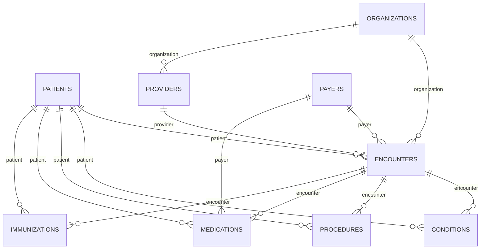

# Table Relationships

Nine related tables from the Synthea CSV export. Keys are documented here and **checked** by `sql/04_dq_checks.sql`; they are intentionally not enforced as database constraints so that dirty data can load and be measured.

| Table | Rows (production) | Unique key | Foreign keys | Checks |
|---|---:|---|---|---|
| patients | 1,141 | `id` | — | MK01, DU01, DT05, DT06 |
| organizations | 312 | `id` | — | DU04 |
| providers | 312 | `id` | `organization` → organizations | MK07, OR05, DU03 |
| payers | 10 | `id` | — | DU05 |
| encounters | 64,622 | `id` | `patient`, `provider`, `organization`, `payer` | MK02–MK06, OR01–OR04, DU02, DU06, DT01–DT04 |
| conditions | 39,922 | none (event) | `patient`, `encounter` | MK08, OR06, OR10, DT09 |
| procedures | 175,055 | none (event) | `patient`, `encounter` | MK09, OR07, OR10, DU07, DT07, DT08 |
| medications | 48,843 | none (event) | `patient`, `encounter`, `payer` | MK10, OR08, OR10, DT10 |
| immunizations | 16,460 | none (event) | `patient`, `encounter` | MK11, OR09, OR10, DU08, DT11 |

## Row identity

Event tables have no natural key, so `python/01_prepare_raw.py` adds a `_row_id` (1..n in file order) to every table. Every failing row in `dq_exceptions` carries its `table_name` and `_row_id`, and the injected-error log uses the same pair, so detection can be scored row by row.

## Cross-key rule (OR10)

An event row's `patient` must equal the `patient` on the encounter it points to. A mismatch means the event is linked to the wrong person even though both keys exist.

## Fields removed before loading

`patients`: SSN, DRIVERS, PASSPORT, PREFIX, FIRST, MIDDLE, LAST, SUFFIX, MAIDEN, BIRTHPLACE, ADDRESS, FIPS, LAT, LON. Synthea's values are fake, but reporting does not need identifier-style fields, so they are dropped as a matter of practice.
